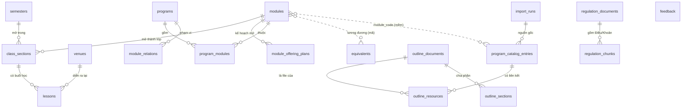

# Thiết kế cơ sở dữ liệu UELCourses

> Trạng thái: **PostgreSQL 17 (Docker) đã tạo bằng Alembic migration `0001` và đã nạp dữ liệu thật** (kiểm chứng 2026-11-21). Code: `api/app/models.py`, `api/migrations/`.
> Nguồn dữ liệu và thư mục `data/`: xem `data/README.md`. Quyết định đã chốt: `docs/DECISIONS.md` (D4).

## 1. Nguyên tắc thiết kế
1. **Một DB, mọi môi trường:** PostgreSQL ở dev (Docker), staging và production. SQLite chỉ dùng cho test nhanh/không Docker (`init_db()` tự tạo bảng ở SQLite; ở PostgreSQL schema do Alembic quản lý).
2. **Schema có phiên bản:** mọi thay đổi bảng đi qua `alembic revision --autogenerate` → commit file trong `api/migrations/versions/`. `alembic check` phải sạch (không lệch mô hình).
3. **Dữ liệu đi qua 3 lớp:** nguồn thô bất biến (`data/raw`, `data/outlines_2025`) → importer/parser (idempotent, có test) → bảng phục vụ. Mỗi lần nạp ghi `import_runs` (nguồn, tên file, sha256, số dòng) để truy vết — dùng được cho chương đánh giá khóa luận.
4. **File lớn ngoài DB:** PDF (733 MB) không vào DB; DB giữ đường dẫn tương đối + sha256 + số trang + văn bản trích xuất. Khi lên web, PDF đặt ở object storage.
5. **Không suy diễn:** trường không biết để `NULL`; giữ nguyên văn (`required_raw`, `previous_raw`, `schedule_raw`, `original`). Cờ `is_sample` tách dữ liệu mẫu khỏi dữ liệu thật.
6. **Tìm kiếm tiếng Việt không dấu:** cột `search_text` (đã bỏ dấu) + chỉ mục trigram GIN (`pg_trgm`); tiện ích `unaccent` có sẵn cho truy vấn tự do.
7. **Liên kết mềm có chủ đích:** `program_catalog_entries.module_code`, `equivalents.code` trỏ tới `modules.code` nhưng **không ép khóa ngoại** (mã môn của nhiều nguồn có thể chưa đồng bộ).
8. **JSON linh hoạt đúng chỗ:** `JsonType` = JSONB trên PostgreSQL (lập chỉ mục được), JSON trên SQLite; `None` luôn là SQL `NULL`.

## 2. Sơ đồ quan hệ


## 3. Các nhóm bảng (số dòng đo ngày 2026-11-21 trên PostgreSQL)
| Nhóm | Bảng | Dòng | Nguồn | Ghi chú |
|---|---|---:|---|---|
| Lịch học | `semesters` | 7 | suy từ mã lớp (`251`→2025-2026-1) | id dạng `2026-2027-1` |
| | `modules` | 1.676 | UIS, DKHP, CTĐT, kế hoạch TA | khóa = `code`; `is_english` nếu tên có `(E)` |
| | `class_sections` | 6.314 | UIS xlsx (225) + quét DKHP (6.089) | `cohorts` suy từ lớp SV `K24404E`→`K24`; khóa duy nhất `(class_code, semester_id)` |
| | `lessons` | 8.226 | tách từ `Schedules` | thứ 2–8 (8=CN), tiết có thể tới 16, giờ theo `config.PERIOD_STARTS` |
| | `venues` | 140 | từ lịch học | |
| | `module_offering_plans` | 183 | `Thong_tin_mon_hoc_TA_2026_2027.xlsx` | học kỳ dự kiến mở, % mở |
| Chương trình đào tạo | `programs` | 86 | portal (CTĐT K19–K26) | `K22404` = khóa 22, ngành 404 |
| | `program_modules` | 6.276 | portal | khối kiến thức, bắt buộc, kỳ gợi ý, cây tiên quyết (JSONB) |
| | `module_relations` | 45.178 | từ cột học trước/tiên quyết | `prereq` \| `previous` \| `coreq` \| `equivalent` |
| | `equivalents` | 3.941 | portal `equivalentcourse` | |
| Đề cương 2025 | `program_catalog_entries` | 3.690 | 18 workbook Excel | chương trình → nhánh (sheet) → môn; `original` JSONB giữ mọi ô |
| | `outline_resources` | 4.736 | cột liên kết trong Excel | `status`: downloaded/failed/no_url (3.365 đã gắn PDF) |
| | `outline_documents` | 783 | `data/outlines_2025/pdfs` | sha256 duy nhất; `text_status`: pending/extracted/needs_ocr/failed |
| | `outline_sections` | (đang nạp) | `outline_documents.text` tách theo mục đánh số | MỌI mục nguyên văn + `search_text` không dấu (trigram) |
| | `outline_courses` | (đang nạp) | mục "Thông tin tổng quát" | 1 dòng/đề cương: tên Việt/Anh, mã, tín chỉ, giờ LT/TH/tự học, tiên quyết/học trước/sau/song hành, ngôn ngữ, giảng viên; `parse_status` ok/partial/failed/skipped |
| | `outline_objectives`, `outline_clos` | (đang nạp) | bảng Mục tiêu (CO) và Chuẩn đầu ra (CLO) | CO↔CLO, mức giảng dạy I/T/U |
| | `outline_assessments` | (đang nạp) | bảng Đánh giá học phần | A1.1…: thành phần, CLO, tiêu chí, thời lượng, trọng số |
| | `outline_schedule`, `outline_materials` | (đang nạp) | kế hoạch giảng dạy theo tuần; giáo trình/tài liệu | |
| Ngôn ngữ giảng dạy | cột `modules.language_track` (`en`/`vi`), `language_basis`, `counterpart_code`; view `v_modules_english`, `v_modules_vietnamese` | 360 EN / 1.316 VI | mã `EXX####` hoặc tên `(E)` | 289 cặp Anh↔Việt (`EEE1038`↔`BEE1038`, `EBBT068`↔`BBBT068`). **29 môn Cử nhân tài năng (CNTN) dạy bằng tiếng Anh do chủ dự án xác nhận** (mã `EXXT###`, tên tiếng Việt) được gắn `cntn_confirmed`; cột `is_talent_program` đánh dấu 46 môn CNTN (40 EN + 6 VI). Còn 34 mã cũ bắt đầu bằng E (`EC01` 22 mã, `EN21` 12 mã — Tiếng Anh 1–4 là môn ngoại ngữ, không phải môn dạy bằng tiếng Anh) xếp VI và gắn `legacy_e_code` để rà soát. Quy tắc: `api/app/services/language.py` |
| Quy chế (RAG) | `regulation_documents` | 28 | `regulations/catalog.json` | `verified`, hiệu lực, khóa áp dụng |
| | `regulation_chunks` | 0 | (RAG ingest — chưa chuyển vào DB) | nguyên văn từng Điều/Khoản + anchor |
| Hệ thống | `import_runs` | 7 | mỗi lần nạp | nguồn, file, sha256, số dòng |
| | `feedback` | 0 | widget góp ý trên web | phục vụ vòng Design Thinking |
| | `alembic_version` | 1 | Alembic | `0001` |

Kích thước DB sau khi nạp: **37 MB** (chưa kể văn bản PDF trích xuất). Dung lượng này nhỏ hơn nhiều hạn mức của các gói Postgres miễn phí (mục 6).

### Cập nhật 2026-11-21 — đã bỏ học phần mã hệ cũ
Theo yêu cầu của chủ dự án, các học phần mã **đúng 4 ký tự có chữ số** (`AA01`, `AC81`, `EN21`, `KT48`… — chỉ dùng cho CTĐT K19–K22) đã bị xóa khỏi DB bằng `python -m app.cli purge-legacy-codes` (CASCADE). Còn lại: **1.214 học phần**, 5.879 lớp, 7.773 buổi học, 2.108 dòng `program_modules`, 2.850 cạnh `module_relations`; tiếng Anh 360 / tiếng Việt 854. Giữ nguyên: bảng `equivalents` (3.941 cặp cũ↔mới) và các mã đặc biệt `GDQP`, `TATC`, `TEST`, `TATC1`, `TATC2`, `2NL01`. Các importer tự bỏ qua mã hệ cũ (cờ `SKIP_LEGACY_CODES`, mặc định bật; quy tắc: `api/app/services/legacy.py`). Bản sao lưu trước khi xóa: `data/db/backups/uelplan_before_legacy_purge_20261121.sql` (68 MB). Hệ quả: 60 chương trình K19–K22 trở nên gần rỗng nên cũng đã bị xóa (`purge-old-programs --before 23`, 280 dòng môn, 657 cạnh; sao lưu `data/db/backups/uelplan_before_old_programs_purge_20261121.sql`) và importer bỏ qua chương trình khóa < K23 (`MIN_PROGRAM_COHORT=23`, đặt 0 để nạp tất cả). Còn **26 chương trình: K23 (8) và K24 (18)** — 1.828 dòng môn, 2.193 cạnh quan hệ. Lưu ý: portal chưa trả chương trình K25, K26 (chỉ có K19–K24).

## 4. Quy ước dữ liệu
- **Khóa sinh viên:** `K22` = tuyển sinh 2022 (2 số cuối năm). `class_sections.cohorts` chỉ suy được từ lớp bắt đầu bằng `K`; các lớp như `C24605`, `MPL1` chưa gán khóa (chờ chủ dự án quyết).
- **Mã lớp học phần:** `<3 ký tự kỳ><mã môn><2 số lớp>`, ví dụ `253BKT500201`. 3 ký tự kỳ: 2 số năm + số kỳ (`253` = 2025, kỳ 3).
- **Môn có nhiều phiên bản:** bản tiếng Anh mã `E…` (vd `EEE1038`) khác bản tiếng Việt `B…` (`BEE1038`). Không gộp chỉ dựa vào tên giống nhau.
- **Dữ liệu mẫu:** cờ `is_sample`; `python -m app.cli clear-sample` xóa khi đã có dữ liệu thật.

## 5. Vận hành
```powershell
.\scripts\dev.ps1 up                       # Postgres + workspace
.\scripts\dev.ps1 migrate                  # alembic upgrade head
.\scripts\dev.ps1 run sh /workspace/scripts/load_all.sh   # nạp toàn bộ dữ liệu (idempotent)
.\scripts\dev.ps1 api python -m app.cli extract-outline-texts   # trích văn bản PDF
.\scripts\dev.ps1 psql
```
- Thêm cột/bảng: sửa `app/models.py` → `alembic revision --autogenerate -m "..."` → xem lại file sinh ra → `alembic upgrade head` → `alembic check`.
- Sao lưu: `docker compose exec db pg_dump -U uelplan uelplan > backup.sql`. Khôi phục: `psql ... < backup.sql`.
- Chuyển sang DB khác (Neon, Supabase…): đặt `DATABASE_URL`, chạy `alembic upgrade head`, rồi `load_all.sh`. Không cần sửa code.

## 6. Hướng phát triển (chưa làm)
| Hạng mục | Bảng/việc | Khi nào |
|---|---|---|
| RAG trong Postgres | nạp `regulation_chunks` (từ segmenter), thêm cột `embedding vector` bằng migration (pgvector, đã có trong image Docker) | khi bật embeddings |
| Phân tích đề cương | điền `outline_sections` từ `outline_documents.text`; OCR các PDF `needs_ocr` (Tesseract tiếng Việt có trong container) | sau khi trích văn bản |
| Người dùng | `users`, `saved_plans`, `course_reviews` (+ đăng nhập qua email trường) | khi cần lưu dữ liệu theo người dùng |
| Vận hành | job nạp định kỳ mỗi học kỳ, kiểm tra dữ liệu (số lớp tăng/giảm), bảng `audit_log` | khi chạy thật |

## 7. Miễn phí khi đưa lên web — những gì tra cứu được (tháng 11/2026; **các số liệu có thể đổi, kiểm tra lại trên trang giá của từng nhà cung cấp**)
Dữ liệu của dự án nhỏ (37 MB) nên mọi gói miễn phí dưới đây đều đủ về dung lượng. Điểm khác nhau là **tính "luôn bật"** và **điều khoản sử dụng**.

| Thành phần | Lựa chọn miễn phí | Hạn chế đáng chú ý |
|---|---|---|
| Frontend (Next.js) | **Vercel Hobby**; hoặc **Cloudflare Pages** | Vercel Hobby chỉ cho dùng cá nhân, phi thương mại — hợp khóa luận. Cloudflare hỗ trợ Next.js qua adapter, kém mượt hơn ([nguồn](https://dev.to/build996/vercel-vs-netlify-vs-cloudflare-pages-free-frontend-hosting-compared-3h9g)) |
| Database | **Neon** (Postgres; compute tự tắt sau ~5 phút rảnh, mở lại trong vài trăm ms, không bị khóa dự án); **Supabase** | Supabase free tạm dừng dự án sau ~1 tuần không hoạt động, 500 MB DB, 1 GB lưu file ([nguồn](https://dev.to/build996/supabase-vs-neon-which-free-postgresql-database-should-you-use-in-2026-1k4)). Các nguồn lệch nhau về hạn mức lưu trữ của Neon (512 MB hay 1 GB) |
| Backend (FastAPI) | **Render** (chạy Docker, nhưng ngủ khi rảnh → khởi động nguội); **Oracle Cloud Always Free** (VM luôn bật, tự cài Docker, cần thẻ để đăng ký) | Render free: băng thông bị cắt giảm trong 2026 theo một nguồn. Hugging Face Spaces: Docker miễn phí có thể đã ngừng ([nguồn](https://dev.to/snapdeploy/free-backend-hosting-7-platforms-that-wont-kill-your-api-2026-1i1g)). Hạn mức Oracle Arm các nguồn nói khác nhau |
| File PDF | object storage miễn phí (Supabase Storage 1 GB; Cloudflare R2 — chưa kiểm chứng hạn mức) | PDF 733 MB: gần chạm 1 GB, nên chỉ đưa PDF cần dùng |

**Lộ trình gợi ý** (đồng bộ với Docker đang dùng): (1) *Demo khóa luận:* Vercel (web) + Render (api, chấp nhận khởi động nguội) + Neon (DB) — không tốn tiền, không cần quản trị server. (2) *Chạy ổn định:* một VM Oracle Always Free chạy `docker compose` (db + api + web) với Caddy làm HTTPS. (3) *Khi có người dùng thật:* chuyển DB sang gói trả phí nhỏ; không cần đổi code vì chỉ đổi `DATABASE_URL`.

Nguồn tham khảo: [so sánh gói miễn phí Neon/Supabase](https://neon.com/guides/neon-vs-supabase-free-plan), [hosting backend miễn phí 2026](https://dev.to/snapdeploy/free-backend-hosting-7-platforms-that-wont-kill-your-api-2026-1i1g), [hạn chế Vercel Hobby](https://vercel.com/docs/plans/hobby).
