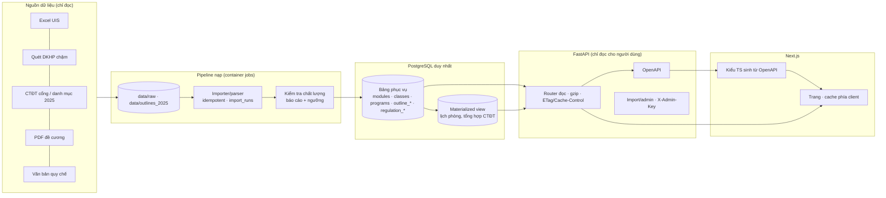

# UELCourses — Đánh giá thiết kế hệ thống & Kế hoạch phát triển

> Lập ngày 2026-11-21 (Claude). Mọi con số dưới đây **đo trực tiếp** trên máy dev ngày này (Postgres trong Docker, API chạy trên máy),
> không ước đoán. Tài liệu này là kế hoạch; quyết định đã chốt nằm ở `docs/DECISIONS.md`, trạng thái từng phiên ở `docs/HANDOFF.md`.

## 0. Tóm tắt

1. **Nền tảng đã đúng hướng** (Next.js + FastAPI + một PostgreSQL duy nhất, Alembic, Docker dùng chung). Phần lớn API trả lời < 75 ms.
2. **Điểm nghẽn thật không nằm ở code mà ở vận hành:** 29 file chưa commit, **không có CI**, nhiều AI chạy dev server song song (4 thư mục `.next*`), image production chưa build lần nào, web tự chuyển sang **dữ liệu giả** khi không gọi được API.
3. **Dữ liệu là tài sản chính và còn lỗ hổng đo được:** đề cương đủ 477/734; 472/970 mã học phần có đề cương đủ; 1.236 cạnh "tương đương" rác trong `module_relations`; 12 PDF scan chờ OCR; mô tả học phần mới có ở 612/1.486 môn.
4. **Hợp đồng API ↔ web đang viết tay hai nơi** (Pydantic và `web/src/lib/types.ts`) → dễ lệch. Nên sinh kiểu TypeScript từ OpenAPI.
5. Kế hoạch 6 giai đoạn (mục 4): **ổn định → hiệu năng & hợp đồng → chất lượng dữ liệu → hoàn thiện MVP → triển khai thử → thử nghiệm người dùng (Design Thinking)**.

## 1. Hiện trạng đã kiểm chứng (2026-11-21)

| Hạng mục | Số liệu | Cách đo |
|---|---|---|
| Database | **Một** PostgreSQL 17 (`uelplan`), 126 MB, Alembic head **0015**, 27 bảng, 21 khóa ngoại (đều validated), 0 dòng mồ côi | `pg_database_size`, `alembic check`, `pg_constraint` |
| Bảng lớn nhất | `outline_sections` 45 MB, `outline_documents` 17 MB, `program_catalog_entries` 16 MB | `pg_total_relation_size` |
| Học phần | 1.486 môn; tên EN 828; mô tả VI 612, EN 353; 1.162 môn có lớp mở | SQL |
| Lớp / buổi học | 5.879 lớp (DKHP 5.724, UIS 155), 7.487 buổi | SQL |
| CTĐT | 76 chương trình (26 từ cổng K23–K24, 50 dựng từ danh mục 2025 cho K25–K26) | SQL |
| Đề cương | 783 PDF (863 file, 80 trùng nội dung); 771 có lớp chữ, 12 scan (`ocr_status='pending'`); **477/734 đề cương `ok`** | `outline_courses` |
| Theo mã học phần (danh mục CTĐT 2025, 970 mã) | 472 đủ đề cương · 195 thiếu một phần · 35 lỗi/khác · 31 có link nhưng chưa tải được · 237 không có link | `module_coverage` (lịch sử phiên) |
| Quan hệ môn | `previous` 1.208, `prereq` 127, `equivalent` 1.236 (**rác**, xem HANDOFF) | SQL |
| Tương đương | 665 dòng / 353 nhóm (chỉ phủ 2 CTĐT của tài khoản lấy dữ liệu) | SQL |
| Quy chế | 50 văn bản; `regulation_chunks` = 0 (RAG dùng chỉ mục file, chưa vào DB); ~8 PDF quy chế scan | SQL, HANDOFF |
| API | 37 endpoint; xem bảng độ trễ mục 1.1 | `bench_api.py` |
| Web | Next 15.5 / React 19, 15 trang (14 là client component), state `zustand` + localStorage, fallback dữ liệu giả `src/mocks/` | đọc mã |
| Test | API: toàn bộ qua (~250 test, SQLite tạm); **RAG: 4 test lỗi** (`test_rag_compare`, `test_rag_index`, 2× `test_rag_vault_graph`); web: **117 Vitest qua**, `tsc` sạch; `npm run build` **chưa kiểm chứng** gần đây; **không có CI** | chạy thật |
| Vận hành | Docker dev: `db`, `workspace`, `jobs`; image production chưa build; sao lưu `data/db/backups/*.dump`; 29 file chưa commit | `docker ps`, `git status` |

### 1.1 Độ trễ API (median 3 lần, sau 1 lần làm nóng, Postgres)

| Endpoint | Trước | Sau tối ưu hôm nay | Ghi chú |
|---|---|---|---|
| `GET /modules?page=1&size=20` | 37 ms | 26 ms | |
| `GET /modules/{code}` · `/classes` · `/outline` | 15–22 ms | — | |
| `GET /modules/{code}/tree` | 71 ms | — | chấp nhận được |
| `GET /equivalents` | 35 ms, **100 KB** | 13 KB (gzip) | |
| `GET /programs` | **239 ms** | **19 ms** | thay nạp toàn bộ học phần bằng 1 truy vấn tổng hợp; kết quả giống hệt (kiểm 3 bộ lọc) |
| `GET /venues` | **462 ms, 2,06 MB** | 473 ms, **141 KB** (gzip) | vẫn chậm phía server → mục 3.C2 |
| `POST /regulations/ask` | 25 ms | — | chế độ extractive |

## 2. Kiến trúc mục tiêu

Nguyên tắc:
1. **Một nguồn sự thật cho dữ liệu:** PostgreSQL (D4). SQLite chỉ cho test. Đã thực hiện 2026-11-21: chạy trên máy tự dùng Postgres, file SQLite cũ ở `data/db/archive_sqlite_20261121/`.
2. **Một nguồn sự thật cho hợp đồng:** schema Pydantic → OpenAPI → kiểu TypeScript sinh tự động. Không viết tay kiểu ở hai nơi.
3. **Pipeline tách khỏi API:** mọi việc nặng (parse, OCR, nạp) chạy trong container `jobs`, idempotent, ghi `import_runs`, có bước kiểm tra chất lượng trước khi ghi đè bảng phục vụ. API người dùng chỉ đọc.
4. **Không có dữ liệu giả ở bản chạy thật:** fallback `src/mocks/` chỉ bật khi `NEXT_PUBLIC_USE_MOCKS=true` (dev/demo), mặc định tắt; khi API lỗi thì hiện lỗi rõ ràng.
5. **Đo trước, tối ưu sau:** mỗi thay đổi hiệu năng kèm số đo trước/sau (như mục 1.1).

## 3. Vấn đề và đề xuất tối ưu (theo tầng)

Ký hiệu: **Ưu tiên** P0 (làm ngay) → P3; **Công** = ngày làm việc ước lượng của một AI.

### A. Vận hành & quy trình

| # | Vấn đề (bằng chứng) | Đề xuất | Ưu tiên | Công |
|---|---|---|---|---|
| A1 | 29 file chưa commit (parser đề cương, migration 0013–0015, cấu hình DB, gzip…) | Commit theo cụm có ý nghĩa: (1) DB & cấu hình, (2) parser đề cương + test, (3) OCR để sau, (4) tối ưu API, (5) tài liệu | P0 | 0,2 |
| A2 | Không có CI; test Postgres chưa từng chạy tự động; `alembic check` chỉ chạy tay | GitHub Actions: service Postgres 17 → `alembic upgrade head` + `alembic check` → `pytest` → `npm ci && tsc && vitest && next build` | P0 | 1 |
| A3 | 4 thư mục `.next*` (nhiều dev server của nhiều AI); HANDOFF nhắc "đừng chạy build khi dev đang chạy" | Quy ước: **một** dev server web trong `workspace` (cổng 3001); build/test dùng `distDir` riêng qua biến môi trường; ghi vào AGENTS.md | P1 | 0,2 |
| A4 | Image production chưa build; `SESSION_SECRET` mặc định `dev-only-change-me` | Build `api`/`web` trong CI; khi `ENV=production` mà còn secret mặc định thì API từ chối khởi động | P1 | 0,5 |
| A5 | Sao lưu thủ công | Lệnh `dev.ps1 backup` (pg_dump `-Fc`, giữ 7 bản) + hướng dẫn khôi phục trong DEPLOY.md | P2 | 0,3 |

### B. Database & dữ liệu

| # | Vấn đề | Đề xuất | Ưu tiên | Công |
|---|---|---|---|---|
| B1 | 1.236 cạnh `module_relations.type='equivalent'` của K23/K24 là rác (tách sai chuỗi `equivalent_raw`) | Sửa parser `equivalent_raw` (tách theo `;` rồi bắt mã 7 ký tự), xóa và dựng lại cạnh; test với chuỗi thật | P0 | 0,5 |
| B2 | Pipeline nạp nằm rải rác (`load_all.sh` + ~25 lệnh CLI) | Một lệnh `python -m app.cli pipeline [--only stage]` với các bước có thứ tự và báo cáo; mỗi bước idempotent | P1 | 1 |
| B3 | Không có số liệu chất lượng dữ liệu cố định (mỗi lần phải viết script) | Lệnh `data-quality` + endpoint `/api/admin/data-quality` (độ phủ đề cương, mô tả, tên EN, lớp không lịch, cạnh lỗi…); số liệu này đưa thẳng vào khóa luận | P1 | 1 |
| B4 | `/venues` tính lịch phòng mỗi lần gọi (473 ms) | Materialized view `venue_sessions` (refresh sau mỗi lần nạp lớp) + API lọc theo học kỳ/ngày/phòng | P1 | 0,5 |
| B5 | Mô tả học phần mới có 612/1.486; 237 mã danh mục không có link đề cương | Bổ sung từ đề cương còn thiếu (C-giai đoạn 2); đánh dấu rõ "chưa có đề cương" trên web thay vì để trống | P2 | — |
| B6 | `outline_sections` 45 MB (giữ cả `text` và `search_text`) | Chấp nhận ở quy mô này; chỉ xem lại khi DB > 1 GB. Đã có chỉ mục trigram và `ANALYZE` | P3 | — |
| B7 | `regulation_chunks` = 0: RAG đọc chỉ mục file, không dùng DB | Quyết định một nơi lưu (đề xuất: DB + `tsvector`/pgvector) để triển khai không phải mang theo file chỉ mục | P2 | 1,5 |

### C. API

| # | Vấn đề | Đề xuất | Ưu tiên | Công |
|---|---|---|---|---|
| C1 | Phản hồi lớn không nén | **Đã làm:** `GZipMiddleware` (≥ 1 KB) | ✓ | — |
| C2 | `/venues` trả 2 MB (mọi phòng × mọi buổi) | Mặc định lọc theo học kỳ hiện tại; thêm `?day=`/`?room=`; định dạng gọn (mảng cột); dùng B4 | P1 | 0,5 |
| C3 | `/programs` 239 ms | **Đã làm:** tổng hợp SQL → 19 ms | ✓ | — |
| C4 | Không có cache HTTP cho dữ liệu gần như tĩnh | `ETag` = phiên bản dữ liệu (id `import_runs` mới nhất) + `Cache-Control: max-age=300` cho học phần/CTĐT/đề cương | P2 | 0,5 |
| C5 | Hợp đồng viết tay hai phía | Xuất `openapi.json` trong CI; sinh `web/src/lib/api-types.ts` bằng `openapi-typescript`; CI báo lỗi nếu lệch | P1 | 1 |
| C6 | Endpoint công khai không giới hạn tần suất (`/regulations/ask`, `/feedback`, `/reviews`) | Giới hạn theo IP (vd. 30 req/phút cho ask/feedback) trước khi mở cho người dùng thật | P2 | 0,3 |

### D. Web

| # | Vấn đề | Đề xuất | Ưu tiên | Công |
|---|---|---|---|---|
| D1 | Khi API lỗi, web âm thầm dùng dữ liệu giả và gắn nhãn "Dữ liệu mẫu" | Tắt mặc định (`NEXT_PUBLIC_USE_MOCKS`), hiện trạng thái lỗi + nút thử lại; giữ mock cho test/demo. **Vùng của Codex** | P0 | 0,5 |
| D2 | 14/15 trang tự `fetch` khi mount, không cache giữa các lần chuyển trang | Lớp cache dùng chung (SWR hoặc TanStack Query), khóa theo URL; prefetch trang chi tiết học phần | P2 | 1 |
| D3 | `next build` chưa kiểm chứng | Đưa vào CI (A2) | P0 | — |
| D4 | i18n còn chỗ thiếu (trang Equivalents, "Chọn khóa và ngành…") | Quét chuỗi cứng bằng lint rule; bổ sung `vi.ts`/`en.ts` | P2 | 0,5 |
| D5 | Khả năng truy cập chưa kiểm | Axe/Lighthouse cho 5 trang chính, sửa lỗi mức A | P2 | 0,5 |

### E. Đề cương & AI quy chế

| # | Vấn đề | Đề xuất | Ưu tiên | Công |
|---|---|---|---|---|
| E1 | 257 đề cương còn thiếu bảng/trường (kế hoạch 82, mục tiêu 82, CLO 78, đánh giá 59, tên 37, tài liệu 30) | Tiếp tục bổ sung luật nhận dạng (đệm bảng thô, lặp offline, `parse-outlines` mặc định chỉ chạy đề cương chưa `ok`); không chạy lại đề cương đủ | P1 | 1–2 |
| E2 | Chưa có bộ chuẩn để báo cáo độ chính xác trích xuất | Gán nhãn tay 30 đề cương (ngẫu nhiên, đủ VI/EN) → precision/recall từng trường; đưa vào khóa luận | P1 | 1,5 |
| E3 | 12 PDF đề cương scan | `ocr-outlines` → kiểm tra mẫu → `parse-outlines` (đã có cột `ocr_*`, đang `pending`) | P2 | 0,3 |
| E4 | 31 mã có link Google Docs/Drive chưa tải được | **Cần chủ dự án đồng ý**: xuất Google Docs → Markdown/PDF bằng tài khoản của họ, không vượt quyền truy cập | P2 | 0,5 |
| E5 | 4 test RAG lỗi; chưa có bộ câu hỏi đánh giá | Sửa test; bộ 50 câu hỏi có đáp án (Điều/Khoản) → đo hit@k cho chế độ extractive | P1 | 1,5 |
| E6 | ~8 PDF quy chế scan | OCR + rà soát tay (văn bản pháp lý cần chính xác tuyệt đối) | P2 | 1 |

## 4. Lộ trình

Thời lượng tính theo ngày làm việc; các giai đoạn 1–3 có thể chạy song song giữa các AI vì khác vùng (API/dữ liệu ↔ web).

### Giai đoạn 0 — Ổn định nền (1–2 ngày) · P0 — **XONG 2026-11-21** (chi tiết: HANDOFF mục 00000000)
- A1 commit theo cụm · A2 CI (Postgres + alembic check + pytest + vitest + tsc + next build) · B1 sửa cạnh tương đương rác · D1 tắt dữ liệu giả mặc định.
- Kết quả: cạnh `equivalent` 1.236 rác → 75 thật; web mặc định không dùng mock (nhãn "Mất kết nối" khi API lỗi); CI đã viết và các bước đã chạy thử trên máy (CI trên GitHub chạy sau khi push). Còn treo: thay đổi dở của Codex trong `web/` chưa commit (không phải của phiên này).
- **Xong khi:** `git status` sạch; CI xanh trên `main`; trang web khi tắt API hiện lỗi thay vì dữ liệu giả; `module_relations` không còn cạnh `equivalent` không phải mã học phần.

### Giai đoạn 1 — Hiệu năng & hợp đồng (2–3 ngày) · P1
- C2 + B4 `/venues` (mục tiêu < 100 ms, < 100 KB) · C5 sinh kiểu TS từ OpenAPI · C4 ETag/Cache-Control · A3 quy ước dev server · A4 kiểm secret production.
- **Xong khi:** bảng độ trễ mục 1.1 đo lại, mọi endpoint đọc < 150 ms ở median; CI báo lệch hợp đồng.

### Giai đoạn 2 — Chất lượng dữ liệu (3–5 ngày) · P1
- B2 lệnh `pipeline` · B3 `data-quality` · E1 bổ sung luật đề cương · E2 bộ chuẩn 30 đề cương · E3 OCR 12 file · E4 (nếu được đồng ý) tải link Google Docs.
- **Xong khi:** báo cáo chất lượng tự sinh; đề cương `ok` ≥ 80% số syllabus; có số precision/recall cho khóa luận.

### Giai đoạn 3 — Hoàn thiện MVP cho thử nghiệm (3–5 ngày) · P1–P2
- E5 sửa và đánh giá RAG · B7 đưa chunk quy chế vào DB · D2 cache phía client · D4 i18n · D5 khả năng truy cập · C6 giới hạn tần suất · cấu hình đăng nhập Google/Facebook cho đánh giá học phần (cần client id của chủ dự án).
- **Xong khi:** luồng chính (tra cứu → chi tiết + đề cương → TKB → kế hoạch nhiều kỳ → hỏi quy chế) chạy được trên dữ liệu thật, không lỗi console.

### Giai đoạn 4 — Triển khai thử (2–3 ngày) · P1
- Build image production · chọn nơi triển khai (cần chủ dự án quyết: VPS/Render/Fly/…) · HTTPS + tên miền · A5 sao lưu tự động · giám sát lỗi cơ bản.
- **Xong khi:** URL công khai chạy bản `main`; khôi phục thử từ bản sao lưu thành công.

### Giai đoạn 5 — Design Thinking: thử nghiệm người dùng (1–2 tuần) · theo `research/`
- Thử với nhóm nhỏ (5–8 SV, nhiều khóa/ngành) theo kế hoạch trong `research/`; thu SUS + widget góp ý; phân tích bằng script có sẵn; 1–2 vòng cải tiến.
- **Xong khi:** có điểm SUS, danh sách vấn đề ưu tiên và thay đổi đã làm — đủ số liệu cho chương đánh giá của khóa luận.

## 5. Cần chủ dự án quyết định

1. **Tải các link Google Docs/Drive còn thiếu** (31 mã học phần) bằng tài khoản của bạn — đồng ý hay bỏ qua?
2. **Nơi triển khai thử** và ngân sách (miễn phí/VPS), tên miền.
3. **Đăng nhập** cho đánh giá học phần: cấp OAuth client Google/Facebook hay tạm tắt tính năng đánh giá.
4. **LLM cho AI quy chế:** giữ extractive (miễn phí) hay bật Claude/Ollama (chi phí, hậu kiểm trích dẫn).
5. **Hạn khóa luận** để xếp thời lượng giai đoạn 5.

## 6. Việc đã làm trong phiên lập kế hoạch (2026-11-21)

- `/programs`: 239 ms → 19 ms (truy vấn tổng hợp, kết quả giống hệt).
- `GZipMiddleware`: `/venues` 2,06 MB → 141 KB, `/equivalents` 100 KB → 13 KB.
- Trước đó trong ngày: một DB duy nhất (Postgres), tắt tự nạp dữ liệu mẫu, cột OCR để sau (migration 0015), đề cương `ok` 11 → 477.
